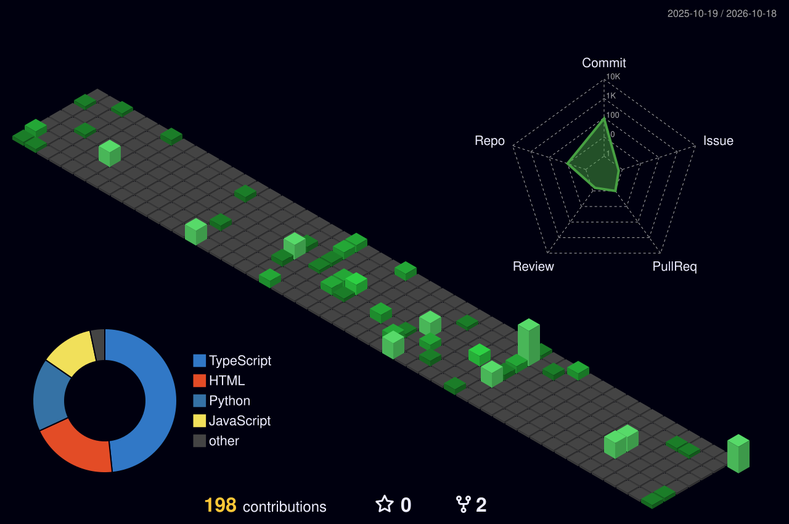

# Hey there, I'm Shlok Shetty!

### Computer Science & Engineering Student | Aspiring Software Developer

---

### About Me:
- Computer Science and Engineering Student at RV University, Bengaluru
- Passionate about Software Development, AI/ML, and Open Source
- Currently working with Python, JavaScript, and Modern Web Frameworks
- Open to collaborating on innovative tech projects and hackathons

---

### Featured Projects:
- **[FreightIQ](https://github.com/shlokbshetty/SIH_Freight-Forecasting)** — Smart India Hackathon platform for freight forecasting and vessel-chartering optimization across India's East Coast ports. Features predictive rate forecasting, berth-feasibility engines, and multi-voyage contract pricing. *(Python, FastAPI, React, TypeScript)*
- **[HistoSight](https://github.com/shlokbshetty/HistoSight)** — Stain-invariant self-supervised learning (SimCLR + ResNet18) pipeline for histopathology tumor classification on PatchCamelyon (PCam), complete with a FastAPI backend and interactive evaluation dashboard. *(PyTorch, Python, SimCLR, FastAPI)*

---

### Socials:

---

### Tech Stack:

---

### GitHub Stats:

---

### GitHub Trophies:

---

### Commit Calendar:

